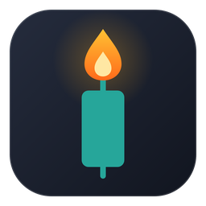
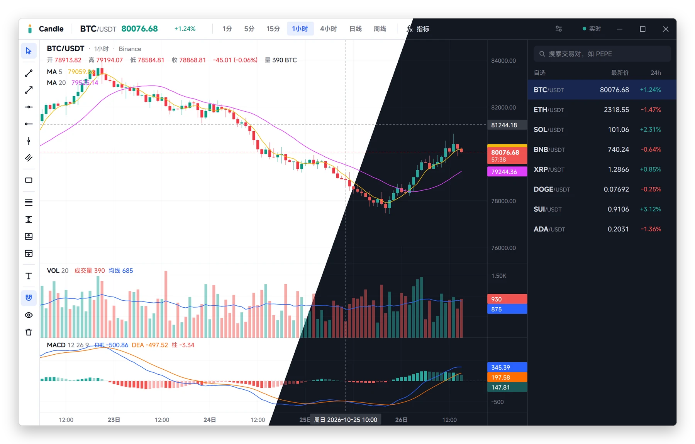
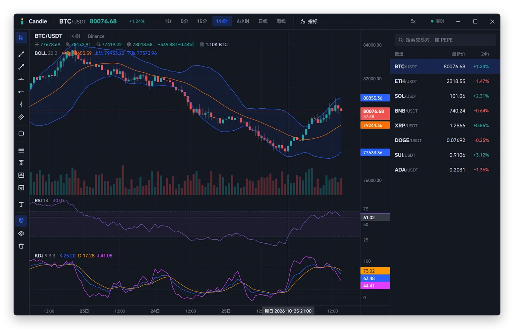
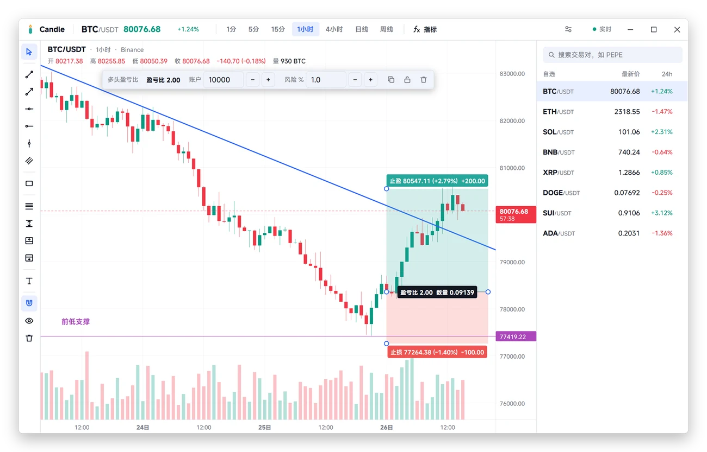
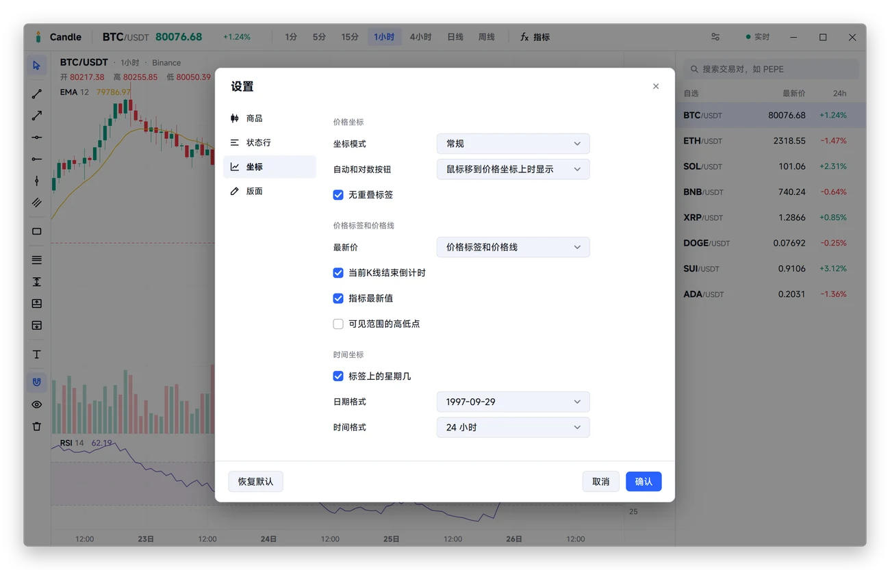
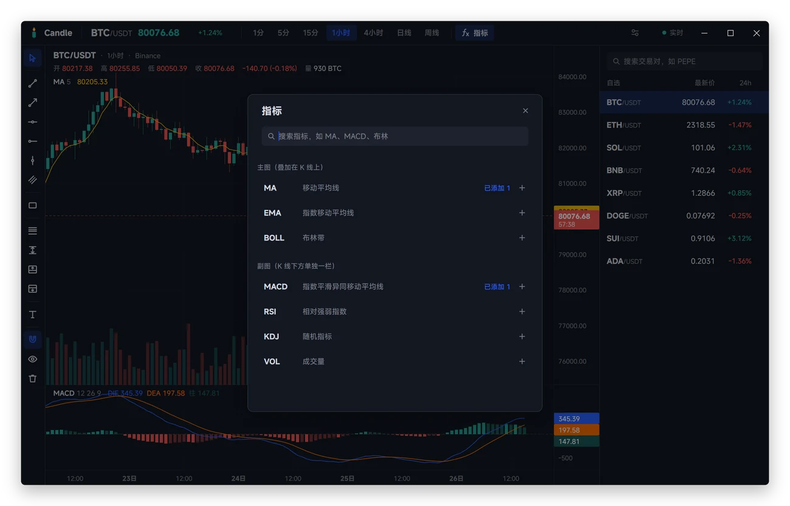

<div align="center">



# Candle

一个照着 TradingView 做的 K 线图：Binance 现货和永续、CME 期货、美股

Go 写的原生 Windows / macOS 程序，不是网页套壳。拖动、缩放、十字光标、指标、画线、盈亏比，手感和 TradingView 对得上；一个 exe 或一个 app，不用账号，不用 API Key。

     



</div>

## 为什么用它

**手感和 TradingView 一样。** 拖动平移，滚轮以鼠标所在的那根 K 线为中心缩放，双击回到最新。价格轴上滚轮或上下拖可以单独缩放价格，常规、百分比、对数三种坐标随时切。十字光标贯穿所有窗格，轴上直接读数；最新价标签带这根 K 线的收盘倒计时，按 Binance 服务器的时钟算。

**指标按 TradingView 的公式算。** MA、EMA、BOLL 叠在 K 线上，MACD、RSI、KDJ、成交量各占一栏，栏与栏之间的线可以拖。同一种指标能加多个（MA5、MA20……），参数、源、偏移、线色、线宽都能改，价格轴上标出每条线的最新值。EMA 首值用 SMA，RSI 用 Wilder 平滑，BOLL 用总体标准差，RSI 的结果和 StockCharts 的公开算例逐个对过。实时推送只重算最后一根；离屏测试里 3000 根 K 线加 8 个指标，一帧约 6 毫秒。

**画线和盈亏比。** 趋势线、射线、水平线、水平射线、垂直线、平行通道、矩形、斐波那契回撤、价格区间、文字，外加多头和空头盈亏比：点一下放好入场、止盈、止损，填上账户金额和风险比例，就能算出该开多少仓、打到止盈止损各赚亏多少。有磁吸，能撤销重做、复制粘贴、锁定。画线按交易对保存，锚点记的是时间，换个周期也落在同一时刻。

**币、永续、期货、美股、A 股、港股放在一起。** 右栏一个搜索框，搜 Binance 现货的 1300 多个交易对、币安 U 本位永续合约（BTCUSDT.P 这种，连 NVDA、黄金这类 TradFi 永续）、CME 的纳指/标普/道指/罗素/黄金/原油期货（NQ、MNQ、ES、MES 这些，大小合约各是各的成交）、纽约上市的美股和 ETF、沪深 A 股、港股、韩股，还有上证指数、深证成指、创业板指、沪深300、科创50、恒生指数、恒生科技、国企指数和 VIX。A 股、港股打代码（600795、00700）或中文名就能搜到。代码、英文名、中文名都能搜：直接打汉字（闪迪、海力士、英伟达、比特币、黄金），或者拼音、首字母（`ywd` 英伟达、`pg` 苹果、`nz` 纳指）；开着输入法打字，还没选字时按拼音搜，选了字按汉字搜，打 sndk 这种代码也不用先按回车。美股的代码清单存在本机，结果马上出来，价格随后补上。结果按现货、永续、期货、美股、A 股、港股、韩股分组，最匹配的一组排前面，每组先列 4 个，「全部 ›」看一组全部；点一下就看、顺手加进自选。自选也按这几类分区，点标题折叠，拖动行和标题调顺序。币的行情实时跳，币和美股前面带着图标；永续的图例里有标记价和资金费率倒计时；期货晚 10 分钟，可以切 ETH（全时段）和 RTH（常规时段，见常见问题）。断线会自动重连并补齐漏掉的 K 线，往左拖到头会自动加载更早的历史。

**设置能调的都给你。** 五种图表类型、涨跌色（一键换绿涨红跌、红涨绿跌、白涨黑跌）、按前收盘价着色、标签颜色（白涨黑跌配白底也看得清）、时区、日期和时间格式、网格、每天一条的交易日分隔线、十字光标样式、水印、边距……改了立刻生效，点取消就还原。浅色、深色或跟随系统。

**小、安静。** Windows 上一个 13 MB 的 exe，macOS 上一个 12 MB 的 app，不用装运行时。只用公开行情，不需要登录，也不碰你的账户。

## 截图

<table>
  <tr>
    <td width="50%"></td>
    <td width="50%"></td>
  </tr>
  <tr>
    <td width="50%"></td>
    <td width="50%"></td>
  </tr>
</table>

## 开始使用

到 [Releases](https://github.com/margbug01/Candle/releases/latest) 下载：

- **Windows 10 / 11**：`Candle-v<版本>-windows-x64.zip`，解压到自己的文件夹（比如桌面或 `D:\Candle`），打开里面的 `Candle.exe`。别放进 `Program Files` 这类没有写入权限的地方，不然没法自己更新。
- **macOS 12 及以上（Apple 芯片）**：`Candle-v<版本>-macos-arm64.dmg`，把 Candle 拖进「应用程序」再打开。第一次打开被系统拦下的话，看下面的常见问题。

- 币的行情来自 Binance 的公开行情服务 `data-api.binance.vision` 和 `data-stream.binance.vision`，不需要 API Key。
- 永续合约来自币安合约的公开接口 `fapi.binance.com` 和 `fstream.binance.com`（同样不要 Key）。它没有国内能直连的镜像，在中国大陆要开代理；没开时搜不到永续，现货不受影响。Candle 里永续写作 `BTCUSDT.P`。
- 期货和美股的行情来自 Yahoo Finance 网页自己用的接口（`query1/query2.finance.yahoo.com`），不是公开 API，Yahoo 随时可能改或限流。在中国大陆要开代理才连得上。Candle 里期货写作 `CME:NQ`、美股写作 `US:AAPL`，币还是 `BTCUSDT`。
- 美股的代码清单来自 Nasdaq 每天发布的全部美股/ETF 列表（`www.nasdaqtrader.com`，约 1 MB，一周更新一次，存进下面说的缓存文件夹），搜美股不用再问 Yahoo；常用的 90 多只带了中文名。清单还没下好时，搜美股退回去问 Yahoo。
- A 股（含指数）和港股的行情来自东方财富网站自己用的接口（K 线 `push2his.eastmoney.com`、报价 `push2.eastmoney.com`，不是公开 API），国内直连，A 股晚约 3 秒、港股几乎实时（Yahoo 上 A 股要晚 30 分钟、港股晚 15 分钟，所以没用 Yahoo）。分钟线东方财富只给最近一个半月左右（1 分钟线只有当天），日线、周线从上市那天起；价格是前复权的，和国内炒股软件一样。小时线、4 小时线用 5 分钟线拼，和 TradingView 一样按开盘算起（港股 11:30 那根只有半小时）。Candle 里 A 股写作 `SSE:600795`（上交所）、`SZSE:000001`（深交所，平安银行；上证指数是 `SSE:000001`），港股 `HKEX:00700`，恒生指数 `HKEX:HSI`。
- 韩股和 VIX 来自 Yahoo：韩股晚 20 分钟（东方财富的韩股分钟线没有成交量），VIX 晚 15 分钟（东方财富没有 VIX）。写作 `KRX:000660`、`CBOE:VIX`。韩股现在只接了 KOSPI 主板（Yahoo 的 .KS）。
- 中文名：币、永续合约和常用的 90 多只美股的中文名写在程序里，不用联网；其他美股的中文名（闪迪、SK海力士这些）来自东方财富网站搜索框用的接口（`searchapi.eastmoney.com`，不是公开 API），只在搜索里打了汉字或数字代码时才问，国内直连，约 0.1 秒。A 股、港股的名字也从这里来。
- 美股的图标来自 Financial Modeling Prep 公开的 logo（`financialmodelingprep.com/image-stock/<代码>.png`，不要 key，国内直连），和币的图标一样只下载一次；没有 logo 的显示首字母。
- 网络连不上 Binance 时，Candle 会走系统代理：Windows 上是「设置 › 网络和 Internet › 代理」，macOS 上是「系统设置 › 网络 › 代理」，Clash、v2rayN、Shoes 打开的就是它；也认 `HTTPS_PROXY` / `HTTP_PROXY` 环境变量。
- 币的图标来自 Binance 官网（`www.binance.com` 的资产列表和 `bin.bnbstatic.com` 上的图片），下载一次就存进缓存文件夹（Windows 上 `%LOCALAPPDATA%\Candle`，macOS 上 `~/Library/Caches/Candle`），以后打开不用再下；列表一周更新一次，遇到列表里没有的新币会马上再问一次。在中国大陆连 binance.com 要开代理，连不上时图标位置显示币名的首字母，行情不受影响。
- 自选、周期、指标、画线和图表设置都存在 `%APPDATA%\Candle\settings.json`（macOS 上是 `~/Library/Application Support/Candle/settings.json`），指标是所有交易对共用的，画线跟着交易对走。
- 能自己更新：「设置 › 关于」里点「检查更新」，有新版本就点「更新并重启」，下载、校验签名、替换，再自己重新打开，通常只下载变了的部分。打开时和之后每 12 小时也会自动问一次 GitHub，有新版本时顶栏右边会提示，只提示不自己装，可以关掉。自己编译的、还在 dmg 里打开的不能自己更新。

### 自己编译

要装 [Go](https://go.dev/dl/)，版本低于 1.27.3 会自动下载对应的工具链。Windows 上：

```powershell
git clone https://github.com/margbug01/Candle
cd Candle/work
go build -trimpath -ldflags="-H windowsgui -s -w" -o ../outputs/Candle.exe .
```

打开 `outputs/Candle.exe` 就能用。

macOS 上用 MyGo 打包成 app（Apple 芯片）：

```sh
git clone https://github.com/margbug01/Candle
cd Candle/work
go run github.com/egoist/mygo/cmd/mygo@v0.6.4 build -skip-dmg
```

打开 `outputs/darwin-arm64/Candle.app`，或者把它拖进「应用程序」。去掉 `-skip-dmg` 会再打一个 dmg。

## 操作

| 操作 | 作用 |
|---|---|
| 拖动图表 | 平移时间；价格被手动缩放过时也上下移动 |
| 滚轮 | 以鼠标为中心缩放时间，所有窗格一起 |
| 价格轴上滚轮、上下拖 | 只缩放这一栏的价格 |
| 双击价格轴 | 这一栏的价格回到自动 |
| 双击图表 | 回到最新一根，恢复默认缩放 |
| 拖窗格之间的线 | 调整副图高度 |
| Esc | 放下画线工具，取消选中 |
| Delete、Backspace（Mac 键盘上的 delete） | 删除选中的画线 |
| Ctrl+Z、Ctrl+Y（macOS：⌘Z、⇧⌘Z） | 撤销、重做画线（Ctrl+Shift+Z、⌘Y 也是重做） |
| Ctrl+C、Ctrl+V（macOS：⌘C、⌘V） | 复制、粘贴画线 |
| 右键图表 | 重置图表、坐标模式、隐藏画线、设置 |
| ⌘,（macOS） | 打开设置 |
| 点自选的分区标题 | 折叠、展开这个分区；拖动标题调换分区顺序 |
| 搜索结果里的「全部 ›」 | 只看这一组的全部结果；「‹ 全部结果」回去 |
| 拖动自选里的一行 | 在它的分区里换位置 |
| 顶栏 ETH ／ RTH（期货） | 全时段 ／ 只看常规时段（纽约 9:30–16:15） |

## 指标怎么算

<details>
<summary>展开看公式</summary>

| 指标 | 默认参数 | 算法 |
|---|---|---|
| MA | 5 | 源（默认收盘价）的简单平均 |
| EMA | 12 | α = 2/(n+1)，第一个值是前 n 根的 SMA |
| BOLL | 20, 2 | 中轨 = SMA(20)；上下轨 = 中轨 ± 2 × 总体标准差 |
| MACD | 12, 26, 9 | DIF = EMA(12) − EMA(26)；DEA = EMA(DIF, 9)；柱 = DIF − DEA |
| RSI | 14 | 涨幅、跌幅各做 Wilder 平滑（RMA，α = 1/n，首值是 SMA） |
| KDJ | 9, 3, 3 | RSV 是收盘价在 9 根最高最低之间的位置；K、D 是逐级的移动平均，从 0 起（同 TradingView 社区的 KDJ 脚本）；J = 3K − 2D |
| VOL | 20 | 成交量和它的 20 根均量 |

MA、EMA、BOLL、MACD、RSI 可以换源（开、高、低、收、hl2、hlc3、ohlc4），MA、EMA、BOLL 可以设偏移。

</details>

## 还没做的

- 北交所、韩国 KOSDAQ 没有接；币安的交割合约（季度）和币本位合约没有接
- A 股、港股的分钟线只能往前翻一个半月左右（东方财富只给这么多）
- CME 期货是晚 10 分钟的；要实时得接券商（以后的事）
- 警报、脚本、多图布局、指标模板
- macOS 只做了 Apple 芯片的版本，没有 Intel 的

## 常见问题

<details>
<summary><b>指标数值和别的软件对不上？</b></summary>

EMA、RSI、MACD 都是递推的，开头几十根会受起点影响，加载的历史越多越接近；Candle 一次加载 1000 根，往左拖还会继续补。KDJ 和国内软件（同花顺、通达信）的差别在起点：它们的 K、D 从 50 起，TradingView 的脚本和 Candle 从 0 起，开头几根不同，之后会收敛到一起。

</details>

<details>
<summary><b>K 线一直加载不出来？</b></summary>

先确认浏览器能打开 <https://data-api.binance.vision/api/v3/ping>。打不开的话，打开代理软件的「系统代理」再重试；Candle 会重新读系统代理（Windows 上每次连接都读，macOS 上最多隔 3 秒），不用重启。目前不支持 PAC 脚本；SOCKS 代理只有 macOS 上认。

</details>

<details>
<summary><b>期货为什么晚 10 分钟？</b></summary>

CME 的实时行情要向交易所付费授权，免费渠道（Yahoo、TradingView 免费版、OpenMarket 免费版）都是晚 10 分钟。Candle 用的是 Yahoo 的数据：价格是交易所的真实成交，落在合约的最小跳动上（NQ 0.25），只是晚到，顶栏右边会写「晚 10 分」。国内门户网站的「实时」外盘期货价是加工过的近似值，和真实成交差几个点，画线、算止损不能用，所以没用。要实时只能接券商（IBKR、Tradovate、富途等）并开 CME 行情，以后会做。美股是 Yahoo 盘中的价格。

Yahoo 自己的数据里，CME 每个交易时段的第一根 5 分钟线（纽约时间 18:00）没有成交量，图上那根量柱是空的，不是 Candle 的问题。

</details>

<details>
<summary><b>期货的 ETH 和 RTH 是什么？</b></summary>

和 TradingView 一样：ETH（Electronic Trading Hours）是 CME 电子盘的整个交易时段，纽约时间 18:00 到第二天 17:00，几乎 24 小时；RTH（Regular Trading Hours）只看常规时段，芝加哥 8:30–15:15，也就是纽约 9:30–16:15（北京时间夏令时 21:30–次日 4:15，冬令时 22:30–5:15），CME、CBOT、NYMEX、COMEX 的合约都一样。看期货时顶栏「指标」左边有 ETH ／ RTH 两个按钮，默认 ETH。

RTH 只管日内周期：日线、周线两种一样（TradingView 也是这样）。RTH 的 1 小时线从 9:30 起算（9:30、10:30…15:30，最后一根 45 分钟），4 小时线是 9:30 和 13:30 两根；Yahoo 的小时线是整点开的，所以这两种是用半小时线拼的，Yahoo 半小时线只有最近 60 天，RTH 的 1 小时、4 小时线也就只能往前拖 60 天。RTH 收盘以后，顶栏的价格是现在的报价，图上停在常规时段最后一根。

</details>

<details>
<summary><b>期货、美股的历史能拖多远？</b></summary>

Yahoo 给多少就有多少：1 分钟线最近 30 天，5 分钟、15 分钟 60 天，1 小时和 4 小时 730 天，日线、周线全部。4 小时线是用 1 小时线从交易时段开头合出来的（期货 18:00、22:00、2:00…，美股 9:30、13:30，纽约时间），和 TradingView 一样。

</details>

<details>
<summary><b>交易日分隔线在哪开？一天从几点算？</b></summary>

「设置 › 版面 › 交易日分隔线」，颜色、线型（虚线、点线、实线）、粗细（1–4 像素）都能改。期货和美股按各自的交易时段画（期货纽约时间 18:00 开盘，美股 9:30），下面说的「一天的起点」只管币。「一天的起点」默认是图表时区的 0 点（跟时间轴上加粗的「29日」对齐）；选「UTC 0 点」就和 Binance 的日线开盘对齐，北京时间是早上 8 点。线画在这一天第一根 K 线的左边沿；12 小时线这类跨过 0 点的 K 线，线画在 K 线里 0 点对应的位置。日线和更大的周期每根 K 线就是一天，不画。

</details>

<details>
<summary><b>币的图标只显示一个字母？</b></summary>

图标要从 binance.com 下载，在中国大陆要开代理（Candle 走系统代理，见上一条）。连不上时先显示首字母，代理开了之后十分钟内会自己再试，或者重新打开 Candle。下载过的图标存在缓存文件夹里，以后断网也能显示。

美股的图标来自 Financial Modeling Prep，国内直连就能下；冷门的股票、ETF 没有 logo，就一直是首字母。期货没有图标来源，都是首字母。

</details>

<details>
<summary><b>macOS 说「无法打开」或「无法验证开发者」？</b></summary>

app 没有 Apple 开发者签名，也没有经过公证，第一次打开会被系统拦下。点「完成」后到「系统设置 › 隐私与安全性」，在最下面点「仍要打开」；也可以在终端运行 `xattr -dr com.apple.quarantine /Applications/Candle.app` 再打开。

</details>

<details>
<summary><b>Windows 弹出「Windows 已保护你的电脑」？</b></summary>

exe 没有代码签名证书，SmartScreen 不认识它。点「更多信息」，再点「仍要运行」。

</details>

<details>
<summary><b>更新装不上？</b></summary>

Candle 要能改写自己所在的位置才能更新：macOS 上把 app 拖进「应用程序」再打开，不要直接从 dmg 里开；Windows 上解压到自己的文件夹，不要放 `Program Files`。连 GitHub 也走系统代理，「检查更新失败」时先看看代理开着没有。实在不行，到 Releases 下载新版本覆盖就行，设置和画线都不在程序里，不会丢。

</details>

<details>
<summary><b>为什么不把字体打包进去？</b></summary>

主题写的是 `MiSans, system-ui`：装了 [MiSans](https://hyperos.mi.com/font/zh/download/) 就用，没装就用系统字体。

</details>

## 构建与开发

```powershell
cd work
go test ./...
go build -trimpath -ldflags="-H windowsgui -s -w" -o ../outputs/Candle.exe .
```

macOS 上：

```sh
cd work
go test ./...
go run github.com/egoist/mygo/cmd/mygo@v0.6.4 build -skip-dmg
```

app 的名字、bundle id 和版本在 `work/mygo.json`。没配开发者证书时是 ad-hoc 签名，本机直接能用；发给别人的话，对方第一次打开会被拦下，要到「系统设置 › 隐私与安全性」里点「仍要打开」。

- 界面测试用 MyGo 的 `ui.Tester` 离屏渲染，真的去点按钮、拖图表；测试不联网。`CANDLE_SHOTS=<文件夹> go test` 会把画面存成 PNG。
- `CANDLE_LIVE=1 go test -run TestLive .` 真连 Binance，跑一遍加载、实时推送、往前补页，并核对指标的增量计算和整段重算一致。
- README 的截图是假数据：`CANDLE_README=<文件夹> go test -run TestReadmeShots .`，再回到仓库根目录 `python tools/shots.py <文件夹> docs/screenshots`（要 Pillow）。
- 图标的母版是 [docs/icon.svg](docs/icon.svg)。exe 的图标、版本和 manifest 在 `work/rsrc_windows_amd64.syso`，改了用 go-winres 重新生成：

```powershell
go run github.com/tc-hib/go-winres@v0.3.3 simply --arch amd64 --icon assets/icon.png --manifest gui --product-name Candle --file-description "Candle K 线图" --product-version 0.4.1 --file-version 0.4.1 --original-filename Candle.exe
```

- macOS 的图标另有母版 [docs/icon-macos.svg](docs/icon-macos.svg)：同一个图案，按 Mac 图标的网格缩到 824 像素，带阴影。改了在 Mac 上回到仓库根目录重新生成 `work/assets/icon-macos.png`（用系统的 Quick Look 渲染，不用装别的）：

```sh
go run tools/macicon.go docs/icon-macos.svg work/assets/icon-macos.png
```

### 发版

两个平台都在 Mac 上一次打出来。应用内更新只认用更新私钥签过名的包，所以发版必须用 `mygo build` 并带上私钥。

1. 改了 `work/go.mod` 的话，在仓库根目录运行 `go run tools/licenses.go` 重新生成 `licenses/`（第三方许可证，随程序发出去；漏了的话 `go test` 会提醒）。
2. 改版本号：`work/mygo.json` 的 `version`，上面 go-winres 命令里的两个版本号（重新生成 syso）。「设置 › 关于」显示的版本直接读 `mygo.json`。
3. 在 [`CHANGELOG.md`](CHANGELOG.md) 写好这个版本的一节，「设置 › 关于」显示的更新说明就是它；缺这一节 `mygo build` 会停下。
4. 在干净的工作区里打包：

   ```sh
   cd work
   MYGO_UPDATER_PRIVATE_KEY="$(cat "$HOME/Library/Application Support/mygo/update-keys/Candle/mygo-update.key")" \
     go run github.com/egoist/mygo/cmd/mygo@v0.6.4 build -platform darwin/arm64,windows/amd64
   ```

5. 在 GitHub 上建 `v<版本>` 的 Release，先存成草稿，把附件都传上去，确认后再发布并设为 Latest。应用读的是最新 Release 里的清单，草稿对它不可见，不会出现清单已经能读到、压缩包还没传完的情况。
   - `outputs/darwin-arm64/`：dmg（改名为 `Candle-v<版本>-macos-arm64.dmg`）、`candle-<版本>-darwin-arm64.tar.gz`、`*.delta`、`update-darwin-arm64.json`
   - `outputs/windows-amd64/`：把 `Candle.exe`、`LICENSE` 和 `licenses/` 放进 `Candle/` 文件夹打成 `Candle-v<版本>-windows-x64.zip`，另附单独的 `Candle.exe`；再加上 `candle-<版本>-windows-amd64.tar.gz`、`*.delta`、`update-windows-amd64.json`

`*.delta` 是从前几个版本到这一版的增量包，`mygo build` 会读已发布的版本自动做出来，应用更新时优先下载它。

公钥写在 `work/mygo.json` 的 `updates` 里。私钥只放在发版的那台 Mac 上，权限 600，不进仓库。私钥丢了，已经装上的应用就收不到后续更新；被别人拿到，他就能给所有用户推任意代码。一定要另外在密码管理器里存一份。

## 致谢

- [MyGo](https://github.com/egoist/mygo)：Go 的原生界面库，Candle 的界面全靠它
- [coder/websocket](https://github.com/coder/websocket)：实时行情的 WebSocket
- [Binance](https://developers.binance.com/docs/binance-spot-api-docs)：公开行情接口
- [TradingView](https://www.tradingview.com/)：界面、交互和指标口径的参照
- [MiSans](https://hyperos.mi.com/font/zh/)：小米的免费商用字体（不随 Candle 分发）

Candle 是个人项目，和 TradingView、Binance 没有关系，也不构成任何投资建议。

## 许可证

Candle 以 [MIT](LICENSE) 发布。编进程序的 MyGo、coder/websocket、Go 标准库等第三方代码按各自的许可证分发，原文都在 [`licenses/`](licenses/)：Windows 版在 `Candle.exe` 旁边，macOS 版在 `Candle.app/Contents/Resources/licenses/`。
